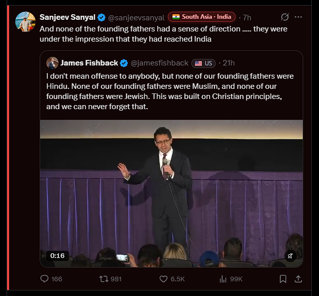
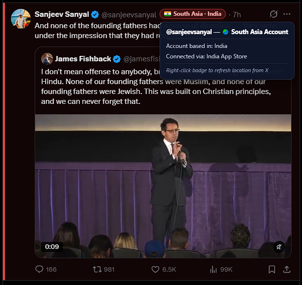

# X Region Highlighter (US · Non-US · South Asia Detector)

A clean, self-contained, **zero-telemetry** Manifest V3 Chrome extension for `x.com` / `twitter.com` that reads X's built-in **"Account based in"** and **"Connected via"** fields (`AboutAccountQuery`) and highlights posts, replies, quote tweets, and user cells using a three-tier visual system.

[**⬇️ Download Latest Release (`x-region-highlighter.zip`)**](https://github.com/S1nned1/x-region-highlighter/releases/latest/download/x-region-highlighter.zip)

---

## 📸 Screenshots

| Inline Region Badges & Post Highlighting | Hover Tooltip (`Based in` + `Connected via`) |
| :---: | :---: |
|  |  |

---

## 🎯 How the Three Tiers Work

1. **🇺🇸 Tier 1 — United States (`United States`, `USA`, `US`, and US territories):**
   - Leaves posts and replies completely unhighlighted (normal look).
   - Displays a subtle, toggleable `🇺🇸 US` badge next to the `@handle`.
2. **🌏 Tier 2 — South Asia (`South Asia`, `Southern Asia`, `India`, `Pakistan`, `Bangladesh`, `Sri Lanka`, `Nepal`, `Bhutan`, `Maldives`, `Afghanistan`):**
   - Gives the tweet/reply container a **high-visibility red/orange left accent bar (`4px solid #ef4444`) and warm background tint**.
   - Adds a prominent red alert badge right next to the username:
     - `🌏 South Asia` when X reports the regional label `"South Asia"`
     - `🇮🇳 South Asia · India` (with country flag + specific country name) when X reports a specific South Asian country
     - Includes `· via <App Store Region>` if the account's App Store / Play Store connection region is South Asia.
3. **🌍 Tier 3 — Other Non-US (any other country or region outside the US and South Asia):**
   - Gives the tweet/reply container a **distinct amber/gold left accent bar (`3px solid #f59e0b`) and subtle amber tint**.
   - Adds a pill badge showing the country/region flag and name (e.g., `🇬🇧 United Kingdom`, `🇨🇦 Canada`, `🇳🇬 Nigeria`, `🇪🇺 Europe`).
4. **⚠️ Smart Signals:**
   - **Connected via App Store / Play Store check (enabled by default):** Even if an account's `Account based in` says `"United States"` (or is hidden), if its `Connected via` field reports a South Asian or other Non-US App Store / Play Store (e.g., `India App Store` or `South Asia Android App`), the extension flags it accordingly and displays both `Based in` and `Via` in the badge and tooltip.
   - **VPN / Proxy Mismatch Indicator (`⚠️`):** Appends `⚠️` to the badge when X reports `location_accurate: false` (possible VPN/proxy mismatch).
   - **Right-Click Force Refresh:** Right-click any badge on X to immediately re-fetch that user's location from X.

---

## 🔒 Privacy & Security Guarantee (Zero Telemetry)

- **Zero third-party servers:** Every network request goes **exclusively** to `x.com` / `twitter.com` using your active browser session's own `AboutAccountQuery` endpoint.
- **No "Community Cache" or analytics:** Unlike third-party store extensions that transmit the `@handles` on your screen to external Cloudflare workers, all lookups and caching stay **100% inside your browser** (`chrome.storage.local` with a 30-day TTL).
- **No silent auto-updates:** Because you load it locally as an unpacked extension, the code on your machine never changes unless you update it yourself.

---

## 🚀 Install in 30 Seconds (Chrome / Brave / Edge)

1. Download [**`x-region-highlighter.zip`**](https://github.com/S1nned1/x-region-highlighter/releases/latest/download/x-region-highlighter.zip) and unzip it into a folder on your computer.
2. Open Chrome and navigate to:
   ```
   chrome://extensions
   ```
3. Turn ON **Developer mode** (toggle switch in the top-right corner).
4. Click **Load unpacked** (top-left button) and select the unzipped `x-region-highlighter` folder.
5. Open or refresh `https://x.com` — badges and highlights will appear automatically as posts scroll into view!

---

## 📁 File Structure

- `manifest.json` — Manifest V3 configuration (permissions limited to `storage`, `unlimitedStorage`, and `*://*.x.com/*`, `*://*.twitter.com/*`).
- `page-script.js` — Runs in `MAIN` world on X to passively harvest `about_profile` payloads from X's own GraphQL responses and queue `AboutAccountQuery` (`XRqGa7EeokUU5kppkh13EA`) lookups with rate-limit backoff and GET/POST bucket fallback.
- `content.js` — Runs in `ISOLATED` world to manage the 30-day `chrome.storage.local` cache, classify accounts into US / South Asia / Other Non-US tiers, render inline badges + hover tooltips, and apply primary-author highlight attributes to tweets/replies/quote-cards.
- `styles.css` — Visual styling for badges, shimmer placeholders, hover tooltips, and South Asia / Non-US post highlights.
- `popup.html` & `popup.js` — Extension popup with instant toggles, live cache breakdown (`Total`, `US`, `South Asia`, `Non-US`), and JSON cache Export/Import/Clear controls.
- `background.js` — Service worker managing default settings and toolbar badge status (`OFF` / `WAIT` / active).
- `icons/` — `icon16.png`, `icon48.png`, and `icon128.png`.
